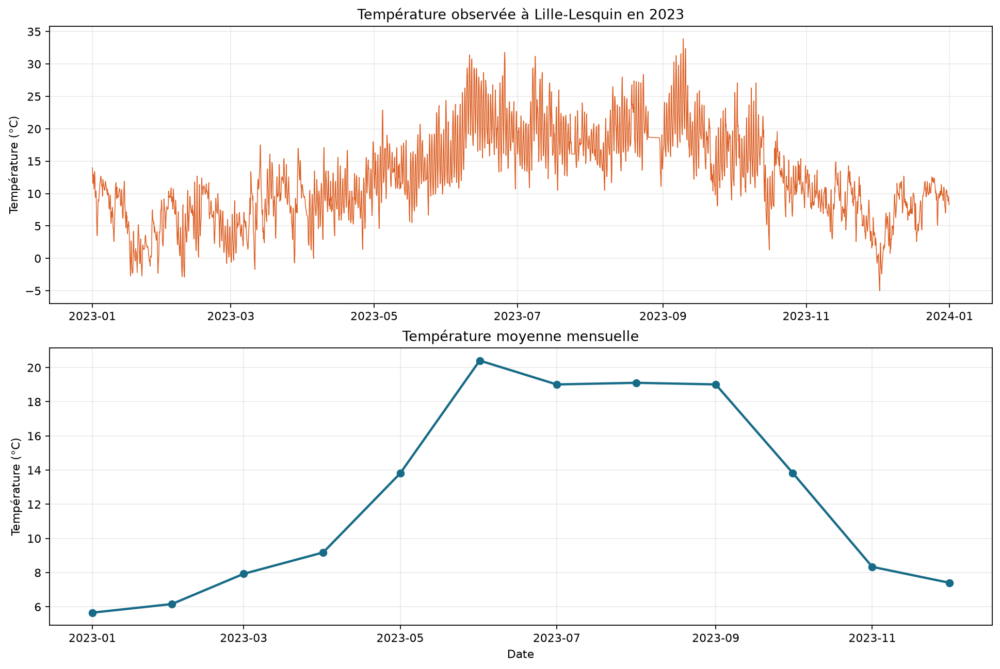
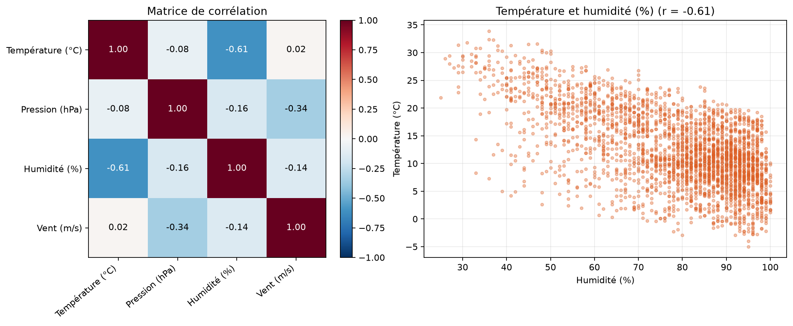
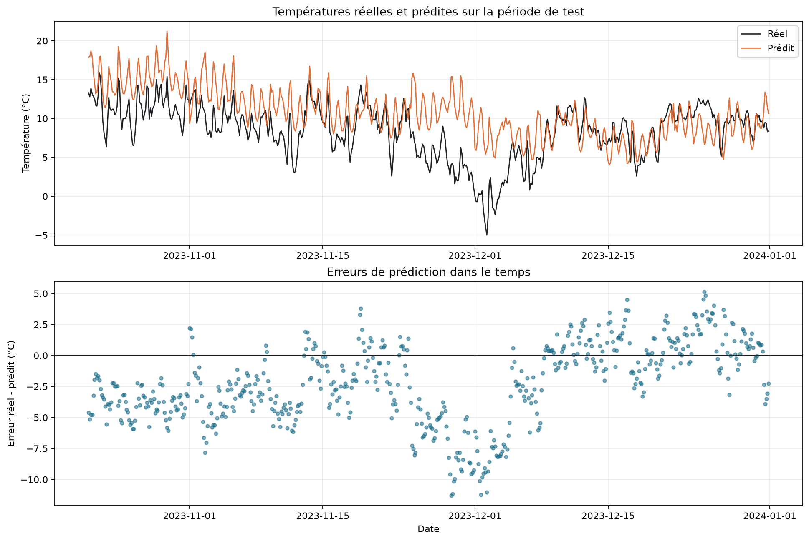

# Projet météo - Lille-Lesquin

Dans ce projet, j'ai travaillé sur les relevés météo de la station de
Lille-Lesquin pour l'année 2023. L'objectif était de partir des données SYNOP
de Météo-France, de les nettoyer, de les explorer, puis d'essayer de prédire la
température avec une régression linéaire.

Le programme principal se trouve dans `projet_meteo.py`. Il réalise toutes les
étapes dans l'ordre : chargement du CSV, vérifications, nettoyage, création des
graphiques, entraînement du modèle et export des résultats.

## Lancer le projet

Le projet utilise Python 3.10 ou une version plus récente.

Pour commencer, il faut créer un environnement virtuel et installer les
dépendances :

```powershell
python -m venv .venv
.venv\Scripts\Activate.ps1
python -m pip install -r requirements.txt
```

Ensuite, le projet se lance avec :

```powershell
python projet_meteo.py
```

Les principaux résultats s'affichent dans le terminal. Le script recrée aussi
les graphiques dans `figures/` et les tableaux CSV dans `resultats/`.

Pour vérifier que les fonctions principales marchent correctement :

```powershell
python -m pytest -q
```

## Données utilisées

Le fichier analysé est `data/lille_lesquin_2023.csv`. Il contient 2 864
observations de la station Lille-Lesquin, identifiée par le numéro OMM `07015`.
Les mesures vont du 1er janvier au 31 décembre 2023, avec normalement une
observation toutes les trois heures. Certains créneaux sont absents des
archives, ce qui explique que le total soit légèrement inférieur aux 2 920
observations théoriques.

Les données viennent des
[archives SYNOP de Météo-France](https://donneespubliques.meteofrance.fr/?fond=produit&id_produit=90)
et sont diffusées sous Licence Ouverte 2.0.

Le fichier fourni dans le dépôt est déjà prêt à être utilisé. Il peut aussi être
recréé à partir des douze archives mensuelles avec :

```powershell
python scripts/preparer_donnees.py
```

## Nettoyage réalisé

Avant de faire les graphiques, j'ai effectué plusieurs vérifications :

- les valeurs `mq` sont reconnues comme des données manquantes ;
- la date est convertie dans un vrai format date/heure ;
- la température d'origine est conservée en kelvins et une nouvelle colonne
  est créée en degrés Celsius ;
- la pression est convertie de pascals en hectopascals ;
- le mois et l'heure sont extraits de la date ;
- la valeur `-0,1 mm` pour les précipitations est considérée comme une trace de
  pluie et remplacée par zéro ;
- les cinq précipitations réellement manquantes ne sont pas remplacées par
  zéro, car une mesure absente ne signifie pas forcément qu'il n'a pas plu ;
- des limites de plausibilité permettent de repérer une température, une
  pression, une humidité ou un vent incohérents.

## Ce que montrent les données

Sur l'année, les températures vont de **-5,0 °C à 33,9 °C**. Le mois le plus
chaud en moyenne est juin avec **20,41 °C**.

Pour les précipitations, environ **80,5 %** des relevés sont nuls. Novembre est
le mois le plus pluvieux de l'année dans ce jeu de données, avec un cumul de
**126,7 mm**.



J'ai également calculé les corrélations entre la température, la pression,
l'humidité et le vent. L'humidité est la variable la plus liée à la température
avec une corrélation de **-0,61**. Cela indique une relation inverse assez nette
dans ces observations, mais pas forcément une relation de cause à effet.



## Régression linéaire

La variable à prédire est la température en degrés Celsius. Pour le modèle
principal, j'ai utilisé :

- la pression au niveau de la mer ;
- l'humidité ;
- la vitesse du vent ;
- le mois et l'heure sous une forme cyclique avec des sinus et des cosinus.

Cette représentation évite par exemple de considérer décembre et janvier comme
deux mois très éloignés. Je n'ai pas utilisé le point de rosée, car il dépend
déjà fortement de la température et aurait donné au modèle une information trop
proche de la valeur à prédire.

Comme les mesures forment une série temporelle, je n'ai pas mélangé les lignes.
Les premiers 80 % servent à l'entraînement et les derniers 20 % au test. Le jeu
de test correspond donc à la période du 21 octobre au 31 décembre.

| Modèle | MAE test | RMSE test | R² test |
|---|---:|---:|---:|
| Météo et variables temporelles | 3,16 °C | 3,96 °C | -0,273 |
| Variables météo uniquement | 3,66 °C | 4,85 °C | -0,906 |
| Prédiction naïve avec la moyenne | 5,12 °C | 6,15 °C | -2,067 |

Le modèle avec les variables temporelles fait mieux que la variante sans ces
variables et que la prédiction naïve. En revanche, son R² de test reste négatif.
Le modèle suit la tendance générale, mais il gère mal certains changements
rapides, notamment le refroidissement de fin novembre et début décembre.

Ce résultat montre surtout les limites d'une régression linéaire pour ce type de
données. La météo dépend de relations plus complexes et les observations prises
toutes les trois heures ne sont pas indépendantes les unes des autres. Les
coefficients dépendent aussi des unités utilisées, donc leur taille ne peut pas
être comparée directement.



## Organisation des fichiers

```text
data/                        données utilisées et informations sur leur origine
figures/                     graphiques produits par le programme
resultats/                   agrégations, corrélations et résultats du modèle
scripts/preparer_donnees.py  préparation du fichier Lille-Lesquin
tests/                       tests des principales fonctions
projet_meteo.py              programme principal
requirements.txt             bibliothèques nécessaires
```

## Assistance utilisée

J'ai utilisé une assistance IA pour m'aider à structurer le projet, vérifier
certaines étapes et améliorer la documentation. J'ai conservé dans le dépôt les
choix de traitement et les résultats nécessaires pour pouvoir expliquer et
reproduire le fonctionnement du programme.
